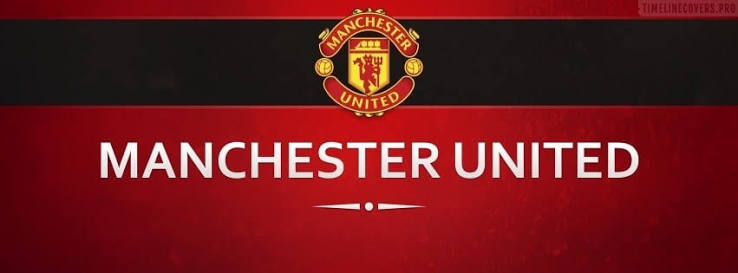
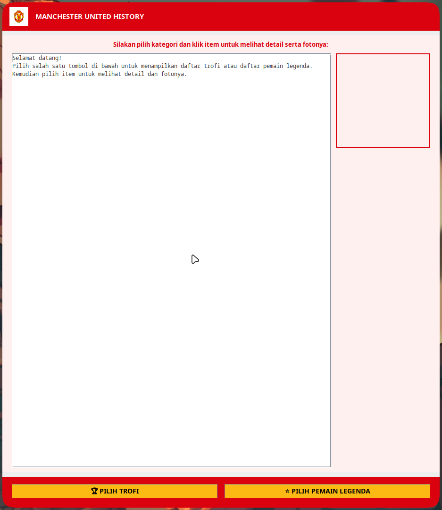
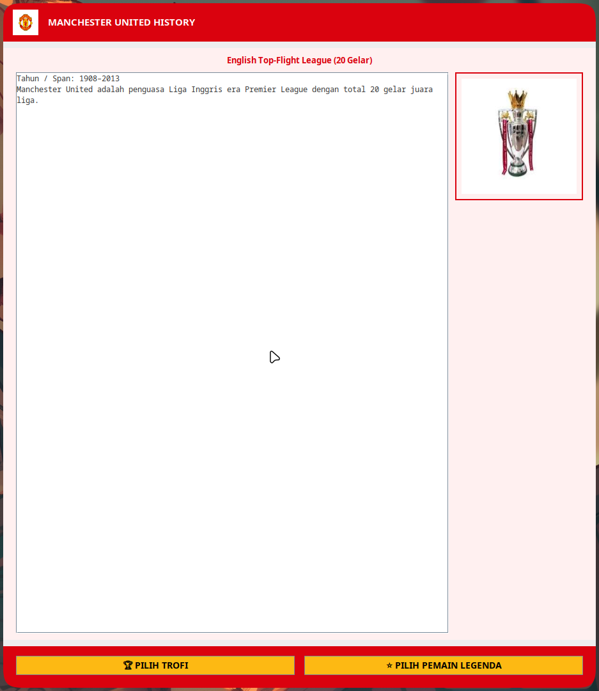
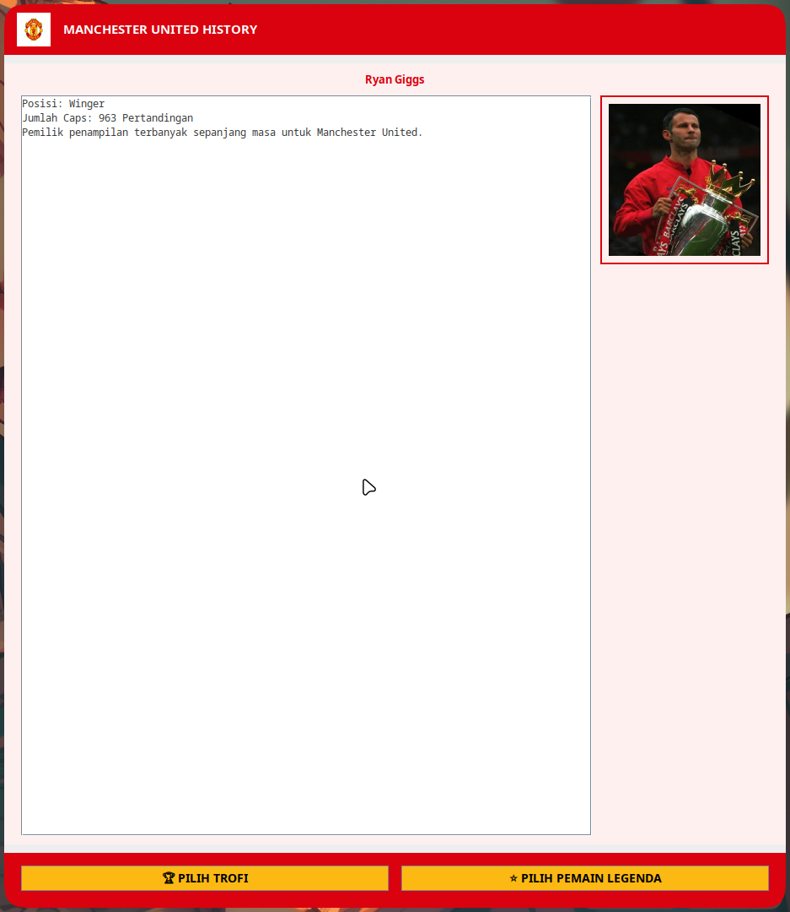

# Manchester United - Trophy & Legends Data Gallery (GGMU.java)

Aplikasi desktop berbasis Java Swing yang menampilkan galeri interaktif sejarah klub sepak bola Manchester United, mencakup daftar trofi kejuaraan yang diraih serta profil para pemain legenda.

---

## Struktur Direktori

Berdasarkan struktur folder proyek:

```text
GUI/
├── _output/
│   ├── Home.png
│   ├── Legends.png
│   └── Trophy.png
├── assets/
│   ├── Banner.jpg
│   ├── logo_mu.png
│   ├── league.jpg
│   ├── facup.jpg
│   ├── ... (aset gambar trofi dan pemain lainnya)
└── GGMU.java
```

---

## Penjelasan Kode Per Blok (Snippet)

### 1. Import Library GUI dan Event Handling
```java
import javax.swing.*;
import java.awt.*;
import java.awt.event.ActionEvent;
import java.awt.event.ActionListener;
```
**Penjelasan:**
* `javax.swing.*`: Mengimpor komponen antarmuka grafis modern Java seperti `JFrame`, `JPanel`, `JLabel`, `JTextArea`, `JButton`, `JScrollPane`, `ImageIcon`, dan `JOptionPane`.
* `java.awt.*`: Mengimpor kelas pendukung tata letak (`BorderLayout`, `FlowLayout`, `GridLayout`), pengaturan warna (`Color`), ukuran (`Dimension`), jenis huruf (`Font`), dan manipulasi skala gambar (`Image`).
* `java.awt.event.*`: Mengimpor `ActionEvent` dan `ActionListener` untuk menangani interaksi pengguna saat tombol ditekan.

---

### 2. Inisialisasi JFrame Utama dan Palet Warna
```java
JFrame frame = new JFrame("Manchester United - Trophy & Legends Data Gallery");
frame.setDefaultCloseOperation(JFrame.EXIT_ON_CLOSE);
frame.setSize(850, 620);
frame.setLocationRelativeTo(null);
frame.setLayout(new BorderLayout(10, 10));

Color warnaMerahMU = new Color(218, 2, 14);
Color warnaKuningMU = new Color(253, 185, 19);
```
**Penjelasan:**
* `JFrame`: Membuat jendela utama aplikasi berukuran `850 x 620` piksel dengan posisi tepat di tengah layar (`setLocationRelativeTo(null)`).
* `EXIT_ON_CLOSE`: Memastikan program berhenti sepenuhnya ketika jendela aplikasi ditutup.
* `BorderLayout(10, 10)`: Membagi area jendela menjadi lima bagian (`NORTH`, `SOUTH`, `EAST`, `WEST`, `CENTER`) dengan jarak antar komponen sebesar 10 piksel.
* `Color`: Mendefinisikan konstanta warna RGB khas Manchester United, yaitu merah (`218, 2, 14`) dan kuning emas (`253, 185, 19`).

---

### 3. Pembuatan Header Aplikasi (`panelAtas`)
```java
JPanel panelAtas = new JPanel(new FlowLayout(FlowLayout.LEFT, 15, 10));
panelAtas.setBackground(warnaMerahMU);

JLabel labelLogo = new JLabel();
ImageIcon iconLogo = new ImageIcon("assets/logo_mu.png");
Image imgLogo = iconLogo.getImage().getScaledInstance(40, 40, Image.SCALE_SMOOTH);
labelLogo.setIcon(new ImageIcon(imgLogo));

JLabel labelJudul = new JLabel("MANCHESTER UNITED HISTORY");
labelJudul.setFont(new Font("Arial", Font.BOLD, 15));
labelJudul.setForeground(Color.WHITE);

panelAtas.add(labelLogo);
panelAtas.add(labelJudul);
frame.add(panelAtas, BorderLayout.NORTH);
```
**Penjelasan:**
* `panelAtas`: Menggunakan `FlowLayout` rata kiri sebagai bilah judul (header) berlatar belakang merah.
* `ImageIcon` & `getScaledInstance`: Memuat file `assets/logo_mu.png` dan mengubah ukurannya menjadi `40 x 40` piksel dengan algoritma `SCALE_SMOOTH` agar gambar tetap tajam saat diperkecil.
* Komponen logo dan teks judul ditambahkan ke `panelAtas`, lalu ditempatkan di bagian atas jendela (`BorderLayout.NORTH`).

---

### 4. Area Konten Utama, Informasi, dan Bingkai Foto (`panelTengah`)
```java
JPanel panelTengah = new JPanel(new BorderLayout(10, 10));
panelTengah.setBorder(BorderFactory.createEmptyBorder(10, 20, 10, 20));
panelTengah.setBackground(new Color(255, 240, 240));

JLabel labelInstruksi = new JLabel("Silakan pilih kategori dan klik item untuk melihat detail serta fotonya:", JLabel.CENTER);
labelInstruksi.setFont(new Font("Arial", Font.BOLD, 13));
labelInstruksi.setForeground(warnaMerahMU);

JTextArea areaInfo = new JTextArea("Selamat datang!\nPilih salah satu tombol di bawah untuk menampilkan daftar trofi atau daftar pemain legenda.\nKemudian pilih item untuk melihat detail dan fotonya.");
areaInfo.setFont(new Font("Monospaced", Font.PLAIN, 12));
areaInfo.setEditable(false);
areaInfo.setLineWrap(true);
areaInfo.setWrapStyleWord(true);
areaInfo.setBackground(Color.WHITE);

JLabel labelGambar = new JLabel("", JLabel.CENTER);
labelGambar.setPreferredSize(new Dimension(200, 200));
labelGambar.setBorder(BorderFactory.createLineBorder(warnaMerahMU, 2));

JPanel panelKanan = new JPanel(new BorderLayout());
panelKanan.setBackground(new Color(255, 240, 240));
panelKanan.add(labelGambar, BorderLayout.NORTH);

panelTengah.add(labelInstruksi, BorderLayout.NORTH);
panelTengah.add(new JScrollPane(areaInfo), BorderLayout.CENTER);
panelTengah.add(panelKanan, BorderLayout.EAST);
frame.add(panelTengah, BorderLayout.CENTER);
```
**Penjelasan:**
* `panelTengah`: Wadah utama yang menampilkan data dinamis dengan padding luar (`EmptyBorder`) dan latar belakang merah muda lembut (`255, 240, 240`).
* `labelInstruksi`: Menampilkan teks panduan awal di bagian atas area tengah, yang nantinya akan berubah menjadi judul trofi atau nama pemain yang dipilih.
* `areaInfo`: Komponen `JTextArea` yang dibungkus `JScrollPane` (agar dapat digulir jika deskripsi panjang). Properti `setEditable(false)` mencegah pengguna mengubah isi teks, sementara `setLineWrap(true)` dan `setWrapStyleWord(true)` memastikan teks terpotong rapi sesuai batas kata.
* `labelGambar`: Bingkai berukuran `200 x 200` piksel dengan garis tepi merah setebal 2 piksel yang diletakkan di sisi kanan (`BorderLayout.EAST`) untuk menampilkan foto trofi atau pemain.

---

### 5. Pembuatan Menu Tombol Navigasi (`panelMenu`)
```java
JPanel panelMenu = new JPanel(new GridLayout(1, 2, 15, 15));
panelMenu.setBorder(BorderFactory.createEmptyBorder(15, 20, 20, 20));
panelMenu.setBackground(warnaMerahMU);

JButton btnTrophy = new JButton("PILIH TROFI");
JButton btnLegends = new JButton("PILIH PEMAIN LEGENDA");
```
**Penjelasan:**
* `panelMenu`: Ditempatkan di bagian bawah jendela (`BorderLayout.SOUTH`) menggunakan `GridLayout(1, 2, 15, 15)` sehingga kedua tombol (`btnTrophy` dan `btnLegends`) memiliki lebar yang simetris.
* Kedua tombol diberi warna latar kuning emas (`warnaKuningMU`), teks hitam tebal, serta `setFocusPainted(false)` untuk menghilangkan garis fokus bawaan saat tombol diklik.

---

### 6. Event Handling Kategori Trofi (`btnTrophy`)
```java
btnTrophy.addActionListener(new ActionListener() {
    @Override
    public void actionPerformed(ActionEvent e) {
        String[] daftarTrofi = {
            "English Top-Flight League (First Division / Premier League)",
            "FA Cup",
            // ... daftar 10 trofi Manchester United
        };

        String pilihan = (String) JOptionPane.showInputDialog(
            frame,
            "Pilih Trofi:",
            "Galeri Trofi MU",
            JOptionPane.QUESTION_MESSAGE,
            null,
            daftarTrofi,
            daftarTrofi[0]
        );

        if (pilihan != null) {
            if (pilihan.contains("Premier League")) {
                labelInstruksi.setText("English Top-Flight League (20 Gelar)");
                areaInfo.setText("Tahun / Span: 1908–2013\nManchester United adalah penguasa Liga Inggris era Premier League dengan total 20 gelar juara liga.");
                ImageIcon icon = new ImageIcon("assets/league.jpg");
                Image img = icon.getImage().getScaledInstance(180, 180, Image.SCALE_SMOOTH);
                labelGambar.setIcon(new ImageIcon(img));
            }
            // ... percabangan else if untuk trofi lainnya
        }
    }
});
```
**Penjelasan:**
* Saat tombol `btnTrophy` ditekan, program menampilkan kotak dialog dropdown melalui `JOptionPane.showInputDialog` yang berisi 10 pilihan trofi dari array `daftarTrofi`.
* Pengecekan `if (pilihan != null)` mencegah error (`NullPointerException`) apabila pengguna menekan tombol *Cancel* atau menutup dialog.
* Berdasarkan opsi yang dipilih (`pilihan.contains(...)`), aplikasi memperbarui teks judul pada `labelInstruksi`, rincian tahun dan deskripsi pada `areaInfo`, serta memuat foto trofi dari folder `assets/` berukuran `180 x 180` piksel ke dalam `labelGambar`.

---

### 7. Event Handling Kategori Pemain Legenda (`btnLegends`) dan Aktivasi Jendela
```java
btnLegends.addActionListener(new ActionListener() {
    @Override
    public void actionPerformed(ActionEvent e) {
        String[] daftarPemain = {
            "Ryan Giggs",
            "Sir Bobby Charlton",
            // ... daftar 15 pemain legenda
        };
        // ... dialog pilihan & percabangan if-else if berdasarkan pilihan.equals(...)
    }
});

panelMenu.add(btnTrophy);
panelMenu.add(btnLegends);
frame.add(panelMenu, BorderLayout.SOUTH);

frame.setVisible(true);
```
**Penjelasan:**
* `btnLegends` bekerja dengan mekanisme serupa menggunakan daftar 15 nama legenda pada array `daftarPemain`.
* Pencocokan pilihan menggunakan `pilihan.equals(...)` untuk menampilkan data posisi bermain, total penampilan (*caps*), biografi singkat, serta foto pemain dari folder `assets/`.
* `frame.setVisible(true)` dipanggil di akhir metode `main` untuk merender dan menampilkan seluruh komponen antarmuka ke layar setelah semua panel selesai disusun.

---

## Output Aplikasi

Tangkapan layar hasil eksekusi program disimpan di dalam folder `_output/` dengan rincian sebagai berikut:

### 1. Tampilan Awal (`_output/Home.png`)

* Menampilkan kondisi awal saat aplikasi pertama kali dijalankan.
* Header atas menampilkan logo Manchester United dan teks judul `MANCHESTER UNITED HISTORY`.
* Area informasi tengah menampilkan pesan selamat datang dan panduan penggunaan, sementara bingkai foto di sisi kanan masih kosong menunggu pilihan pengguna.

### 2. Tampilan Galeri Trofi (`_output/Trophy.png`)

* Menampilkan hasil setelah pengguna menekan tombol **PILIH TROFI** dan memilih salah satu item dari dialog dropdown.
* Judul tengah berubah menjadi nama trofi beserta jumlah perolehannya, area teks menampilkan rentang tahun juara dan deskripsi sejarah trofi, serta bingkai kanan menampilkan gambar trofi yang sesuai.

### 3. Tampilan Galeri Pemain Legenda (`_output/Legends.png`)

* Menampilkan hasil setelah pengguna menekan tombol **PILIH PEMAIN LEGENDA** dan memilih salah satu pemain dari daftar.
* Judul tengah berubah menjadi nama pemain terpilih, area teks menampilkan posisi bermain, jumlah penampilan (*caps*), dan profil singkat pemain, serta bingkai kanan menampilkan foto pemain legenda tersebut.